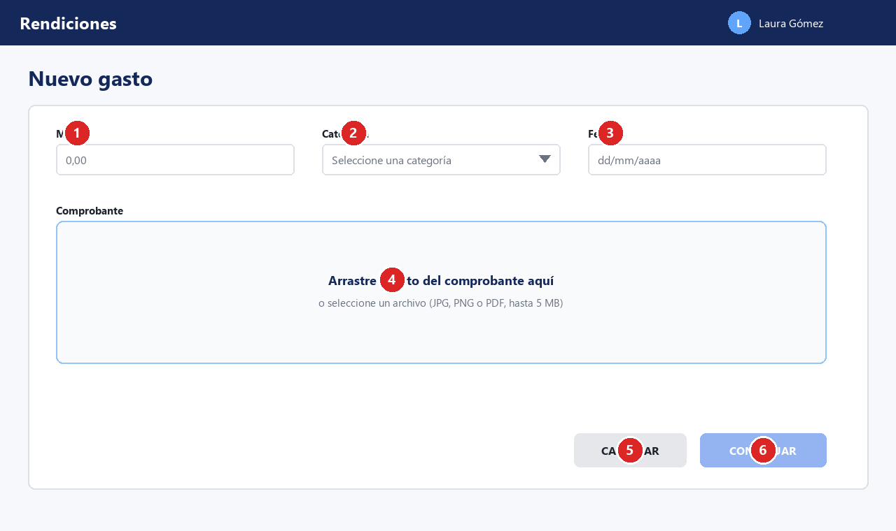
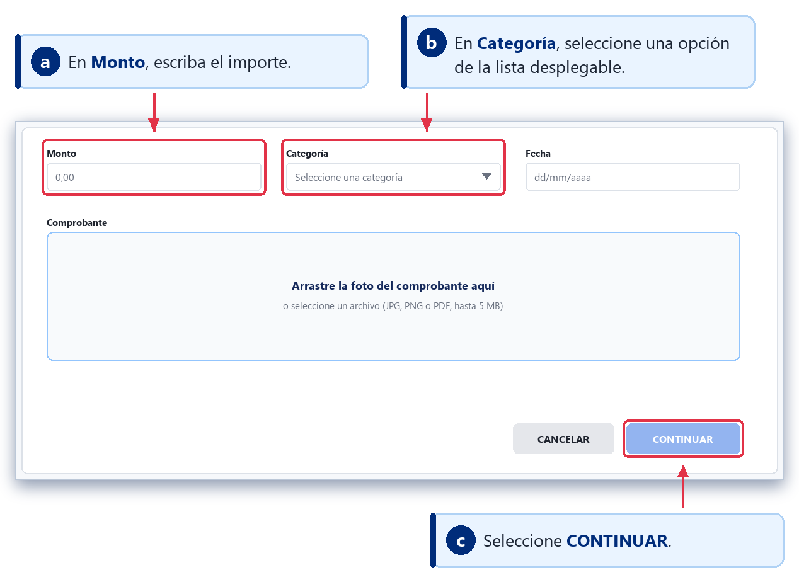

# Visual instructions — a Claude skill

A skill for [Claude](https://claude.com) that designs user manuals, how-to guides, tutorials and SOPs for people who will not read them: one action per step, an annotated screenshot for every step, concise copy and a clear hierarchy.

Works in Spanish and English. *([Leer en español](#en-español))*

## What it does

The reader of a manual is in the middle of a task, glancing between the document and the real screen. The skill makes Claude write for that reader: at every moment, the next action is obvious at a glance.

| Without the skill | With the skill |
|---|---|
|  |  |
| Numbered pins cover the labels and send the reader to a legend. | Each control is framed, and its instruction sits beside it. |

Claude uses it when you ask it to:

- write a manual, user guide, tutorial, quick reference or job aid from screenshots;
- review or redesign a guide that is confusing, too long or that nobody reads;
- apply a client's or reviewer's corrections to an existing manual.

## What is inside

```
visual-instructions/
├── SKILL.md                     the rules and the way of working
├── references/
│   ├── writing-rules.md         wording, formats, structure
│   ├── figure-patterns.md       how to annotate screenshots
│   ├── checklist.md             review list before delivering
│   └── revisions.md             how to handle correction rounds
├── scripts/
│   ├── annotate.py              draws rectangles, arrows and instruction cards on a screenshot
│   ├── contact_sheet.py         one sheet with a close-up of every rectangle, for checking
│   └── stitch.py                joins two captures of a scrolling window
└── assets/
    ├── template.html            document template (hierarchy, steps, callouts, figures)
    └── examples/                a good and a bad version of the same figure
```

## Install

**Claude Code** — copy the `visual-instructions` folder into your skills folder:

```bash
git clone https://github.com/milagrosgonzalezarguello-des/visual-instructions-skill.git
```

```bash
cp -r visual-instructions-skill/visual-instructions ~/.claude/skills/
```

Use `.claude/skills/` inside a project instead if you want it for that project only.

**Claude.ai and the desktop app** — download this repository (Code → Download ZIP), compress the `visual-instructions` folder on its own as a ZIP, and upload it in Settings → Capabilities → Skills.

## Requirements

The scripts need Python 3 with [Pillow](https://python-pillow.org) (`stitch.py` also needs NumPy). With [uv](https://docs.astral.sh/uv/) the dependencies install themselves: `uv run annotate.py spec.json out.png`.

## Try it

- "Te paso las capturas, armame el instructivo para cargar un gasto."
- "Review this user guide: people say it is too dense."
- "The client sent these corrections to the manual. Apply them."

## En español

Una skill para Claude que diseña manuales de usuario, instructivos, tutoriales y procedimientos para gente que no los va a leer: una acción por paso, una captura anotada en cada paso, texto breve y jerarquía clara. Funciona en español (usted, vos o tú) y en inglés.

**Instalación en Claude Code:** copie la carpeta `visual-instructions` dentro de `~/.claude/skills/`.

**Instalación en Claude.ai o la app de escritorio:** descargue el repositorio (Code → Download ZIP), comprima solo la carpeta `visual-instructions` como ZIP y súbala en Configuración → Capacidades → Skills.

## License

[MIT](LICENSE)
